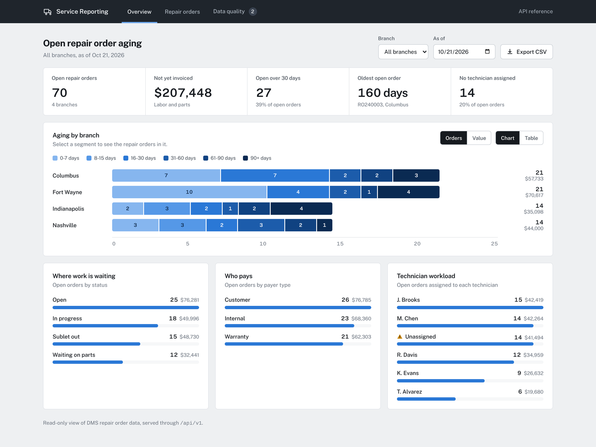

# Open Repair Order Aging

[](https://github.com/VijayChamakuri/dealership-ro-aging/actions/workflows/ci.yml)


I rebuilt the Excel report a service manager uses to see open repair orders by branch, by how many days they have been open, and by the labor and parts dollars that are not invoiced yet.

The data is synthetic. `scripts/generate_sample_data.py` writes `data/sample/repair_orders.csv` with a fixed seed, in the shape of a dealer management system (DMS) export.

On 21 October 2026 the service counts 70 open repair orders (ROs) and $207,447.95 of labor and parts. The Excel VBA (Visual Basic for Applications) macro counts 75 ROs and $221,133.92. The gap is five orders, and each one has a cause.



| Report | Open ROs | Labor and parts |
| --- | ---: | ---: |
| Excel macro | 75 | $221,133.92 |
| This service | 70 | $207,447.95 |
| Macro minus service | 5 | $13,685.97 |

All branches, 21 October 2026. Dollars are labor plus parts, in cents.

An open RO has a status that, after trimming spaces and ignoring case, is not closed, invoiced, or void, and it has an open date. The page rounds each dollar figure to the nearest dollar, so the same three amounts show up there as $207,448, $221,134, and $13,686.

RO240004, RO240009, and RO240016 are closed once spacing and case are fixed, so the service drops them. RO240023 has no open date, so the service drops it. RO240031 is in the file twice, and the service keeps one copy. Branch, status, and technician splits are in [docs/RESULTS.md](docs/RESULTS.md).

## How it works

### The macro

[`legacy/RO_Aging_Report.bas`](legacy/RO_Aging_Report.bas) reads every repair order through a database connection stored in the workbook. It keeps a row unless the status is exactly `Closed`, `Invoiced`, or `Void`, then puts days open into the buckets 0-7, 8-15, 16-30, 31-60, 61-90, and 90+. `On Error Resume Next` wraps the whole routine. I wrote up what that does in [docs/legacy-analysis.md](docs/legacy-analysis.md).

### Three changes that move the totals

Status is trimmed and compared in upper case, so `Closed `, `closed`, and `INVOICED` count as closed. A blank open date stays out of the aging and is listed for correction, because the macro reused the previous row's age. A repeated RO number counts once, and the later row wins. The workbook login is the fourth finding. It does not change the totals. Bucket edges and settings are in [docs/METHODOLOGY.md](docs/METHODOLOGY.md).

### What serves the page

[`sql/01_staging.sql`](sql/01_staging.sql), [`sql/02_views.sql`](sql/02_views.sql), and [`sql/03_procedures.sql`](sql/03_procedures.sql) are those rules written for SQL Server. The process that serves the page does not call them. [`src/ro_aging/repository.py`](src/ro_aging/repository.py) runs the same buckets on SQLite, loaded from the comma-separated values (CSV) file when the process starts. [`src/ro_aging/api.py`](src/ro_aging/api.py) is the web API (application programming interface): it serves `/api/v1` and checks the `X-API-Key` header with `secrets.compare_digest`.

```python
_BUCKET_CASE = """
    CASE
        WHEN age_days <= 7  THEN '0-7'
        WHEN age_days <= 15 THEN '8-15'
        WHEN age_days <= 30 THEN '16-30'
        WHEN age_days <= 60 THEN '31-60'
        WHEN age_days <= 90 THEN '61-90'
        ELSE '90+'
    END
"""
```

### Reconciling to the macro

[`src/ro_aging/legacy.py`](src/ro_aging/legacy.py) is a Python port of the macro, defects included. Each fix is a flag on `Corrections`. [`src/ro_aging/reconciliation.py`](src/ro_aging/reconciliation.py) runs the port with the flags off and labels every extra inclusion. On this file those are the five ROs named above, and the unexplained list is empty. The data-quality tab reads that same payload.

### The page

[`src/ro_aging/static/`](src/ro_aging/static/) is one web page, one stylesheet, and one script. Public Sans is served from the repo. The page does not load fonts or scripts from another site. Colors follow the browser light or dark setting, and the layout reflows below 720 pixels. `make demo` writes one file with the sample responses embedded.

## Design decisions

| Choice | Why | Cost |
| --- | --- | --- |
| Port the macro with the defects left in | Each extra order gets a name | Bucket rules live in `legacy.py` and again in `repository.py` |
| SQLite inside the API process | Local runs and tests need no database server | Tests do not execute the files in `sql/` |
| Load the CSV when the process starts | The API only reads, and the sample is one small file | A new file shows up after a restart |
| One shared API key | The page and scripts send a single header | There is no per-person login |
| Keep waiting-on-parts and sublet orders open | That is what the macro counted | They share buckets with work that is in the shop |

## Evaluation

32 tests in three files. [`.github/workflows/ci.yml`](.github/workflows/ci.yml) runs ruff and pytest on Python 3.11 and 3.12 for pushes to `main` and for pull requests.

- [`tests/test_parity.py`](tests/test_parity.py) (3). With all three corrections on, every branch and bucket matches the port to the cent. With them off, the only RO numbers with a different count are the five named above. Each correction on its own has to come in below 75 and at or above 70.
- [`tests/test_repository.py`](tests/test_repository.py) (6). Summary count and dollars match the detail rows. Closed statuses stay out. Each RO number appears once. Ages land in the right bucket. A blank open date is an exception and is not aged. A branch filter returns only that branch.
- [`tests/test_api.py`](tests/test_api.py) (14). The seven `/api/v1` routes return 401 with no key and 401 with a wrong key.
- [`tests/test_api.py`](tests/test_api.py) (9). Health is public. The other checks cover summary shape, oldest-first detail, an unknown branch (404), a bad bucket and a bad date (422), breakdown totals, the Nashville CSV, and finding dollars that sum to the $13,685.97 gap.

## Limitations

- The CSV is generated. Branch names, technician names, amounts, and the status, date, and duplicate problems all come from the generator.
- The figures on this page come from the SQLite queries. Nothing in `make test` or `make run` executes the SQL Server scripts.
- The key is shared. The page keeps it in `sessionStorage` for the browser tab.
- Waiting on Parts and Sublet Out are inside the 70. Whether they belong there is still an open question in the [legacy write-up](docs/legacy-analysis.md).

## What I'd do next

- Run the scripts in `sql/` on SQL Server and point the API at that database, with the same parity checks.
- Replace the shared key with a login per person.
- Load a new export without restarting the process.
- Take waiting-on-parts and sublet out of these buckets if they should be reported on their own.

## Run it

Python 3.11 or newer.

```bash
python3 -m venv .venv
source .venv/bin/activate
pip install -e ".[dev]"
make run
```

Open http://127.0.0.1:8000 and enter the API key `local-dev-key`. The page sets the report date to 21 October 2026, the date this sample and the picture use. `make test` runs the 32 tests. `make lint` runs ruff.

On Windows, activate with `.venv\Scripts\activate`. Docker, a fresh CSV, the static snapshot, and the SQL scripts are in [docs/RUNNING.md](docs/RUNNING.md).

## Repo map

| Path | Description |
| --- | --- |
| [`src/ro_aging/api.py`](src/ro_aging/api.py) | Web routes, the API key check, and CSV export |
| [`src/ro_aging/repository.py`](src/ro_aging/repository.py) | Loads the CSV into SQLite and runs the aging queries |
| [`src/ro_aging/legacy.py`](src/ro_aging/legacy.py) | Python port of the VBA macro, defects included |
| [`src/ro_aging/reconciliation.py`](src/ro_aging/reconciliation.py) | Labels each extra inclusion in the macro's count |
| [`src/ro_aging/config.py`](src/ro_aging/config.py) | API key, export path, and log level from the environment |
| [`src/ro_aging/static/`](src/ro_aging/static/) | The page files: markup, styles, script, and fonts |
| [`sql/`](sql/) | SQL Server staging table, clean view, aging function, and procedures |
| [`legacy/RO_Aging_Report.bas`](legacy/RO_Aging_Report.bas) | The original VBA macro |
| [`data/sample/repair_orders.csv`](data/sample/repair_orders.csv) | Synthetic export read by the app and the tests |
| [`scripts/generate_sample_data.py`](scripts/generate_sample_data.py) | Rewrites that CSV from seed 21 |
| [`scripts/build_static_demo.py`](scripts/build_static_demo.py) | Writes a one-file snapshot of the page under `dist/` |
| [`tests/`](tests/) | Parity, repository, and API tests (32 in total) |
| [`docs/legacy-analysis.md`](docs/legacy-analysis.md) | What the macro does, and the four findings |
| [`docs/METHODOLOGY.md`](docs/METHODOLOGY.md) | Bucket bounds, filters, the API, and settings |
| [`docs/RESULTS.md`](docs/RESULTS.md) | Full sample figures, in cents, plus the rounded page amounts |
| [`docs/RUNNING.md`](docs/RUNNING.md) | Docker, SQL scripts, regenerating the CSV, and the snapshot |
| [`.github/workflows/ci.yml`](.github/workflows/ci.yml) | Ruff and pytest on Python 3.11 and 3.12 |
| [`Makefile`](Makefile) | `install`, `run`, `test`, `lint`, `demo`, and `docker` |

MIT license. Public Sans is under the SIL Open Font License ([`src/ro_aging/static/fonts/OFL.txt`](src/ro_aging/static/fonts/OFL.txt)).
