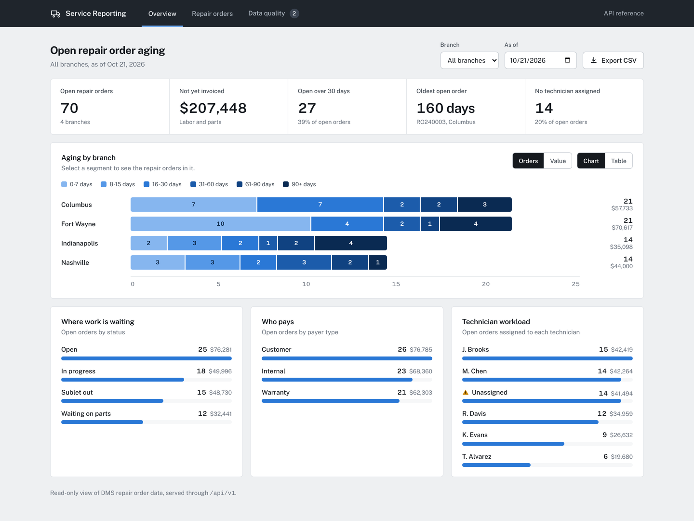
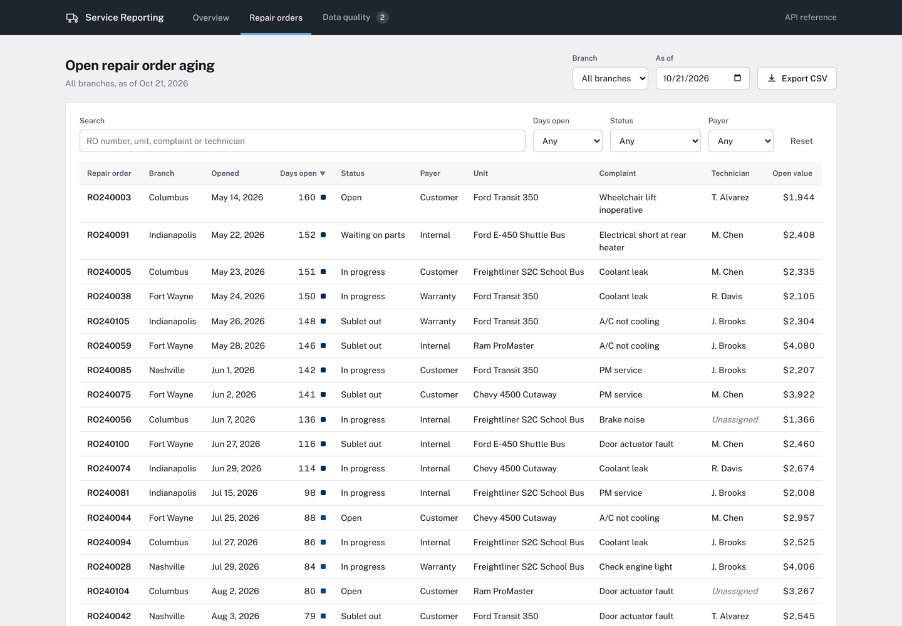
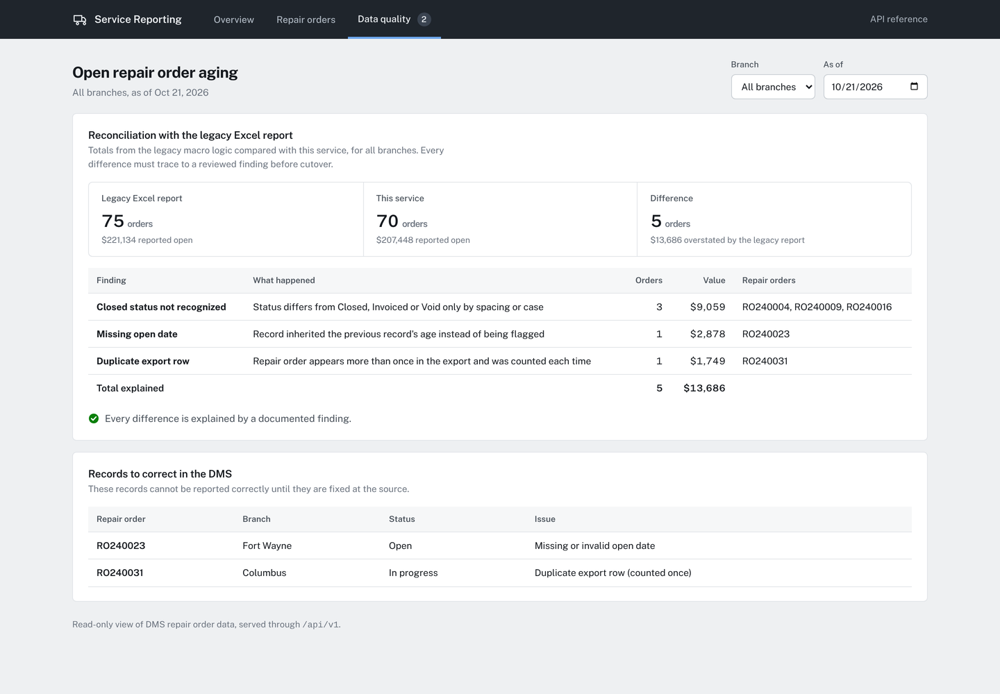
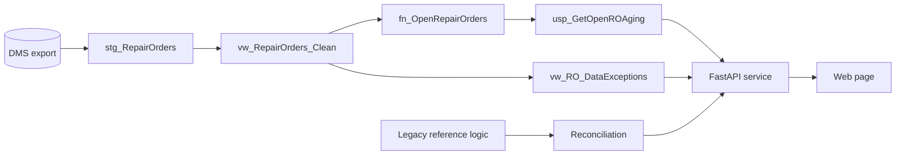

# Open Repair Order Aging

[](https://github.com/VijayChamakuri/dealership-ro-aging/actions/workflows/ci.yml)


A service department report that shows how many repair orders are open at each branch, how long they have been open, and how much labor and parts value has not yet been invoiced.

The project replaces a legacy Excel VBA report that connected directly to the dealer management system (DMS) database. Business logic moves into SQL Server, data is served through an authenticated REST API, and a web interface sits on top. The legacy logic is kept as a reference implementation so every difference between the old and new figures can be reconciled before cutover.



## Features

| Area | What it provides |
|---|---|
| Overview | Headline figures, aging by branch as a chart or table (by order count or value), open work by status, payer type and technician |
| Repair orders | Searchable, sortable, paginated list with filters for days open, status and payer; selecting a chart segment opens the matching orders |
| Data quality | Live reconciliation against the legacy Excel report, with every difference attributed to a finding, and a list of records to correct in the DMS |
| Export | CSV download of the current view for use in Excel |
| API | Versioned REST endpoints with API key authentication and OpenAPI documentation at `/docs` |

<table>
  <tr>
    <td></td>
    <td></td>
  </tr>
</table>

## Highlights

- **Legacy behavior documented before rebuilding.** Review of the macro found four issues, three of which changed the reported figures. See [docs/legacy-analysis.md](docs/legacy-analysis.md).
- **Verified parity.** With the approved corrections applied, the service matches the legacy logic exactly for every branch and age bucket. Every remaining difference is attributed to a documented finding.
- **No direct database access from clients.** Requests go through a versioned API secured with an API key.
- **Data quality surfaced, not hidden.** Records that cannot be reported correctly are listed for correction in the DMS.
- **Self-contained front end.** No framework or CDN dependencies; fonts are served locally, and the interface supports light and dark mode, keyboard navigation and small screens.

## Architecture



| Layer | Responsibility |
|---|---|
| `sql/` | SQL Server objects: staging table, cleansing view, aging function, stored procedures, exceptions view |
| `src/ro_aging/repository.py` | Query layer. Runs the same rules on SQLite for local development and tests |
| `src/ro_aging/api.py` | REST API with authentication, input validation, CSV export and OpenAPI documentation |
| `src/ro_aging/legacy.py` | Python implementation of the legacy macro, including its defects, used for reconciliation |
| `src/ro_aging/reconciliation.py` | Compares legacy and service totals and attributes each difference to a finding |
| `src/ro_aging/static/` | Web interface: overview, repair orders and data quality views |
| `legacy/` | Original VBA macro, retained for reference |
| `tests/` | Parity, business rule and API tests |

## Getting started

Requires Python 3.11 or later.

```bash
python -m venv .venv
source .venv/bin/activate          # Windows: .venv\Scripts\activate
pip install -e ".[dev]"
cp .env.example .env               # set RO_API_KEY
make run                           # or: uvicorn ro_aging.api:app --reload
```

Open http://127.0.0.1:8000 for the web page and http://127.0.0.1:8000/docs for the interactive API reference.

### Docker

```bash
cp .env.example .env
docker compose up --build
```

## Configuration

| Variable | Description | Default |
|---|---|---|
| `RO_API_KEY` | Key required in the `X-API-Key` header | `local-dev-key` |
| `RO_EXPORT_PATH` | Path to the repair order export | `data/sample/repair_orders.csv` |
| `RO_LOG_LEVEL` | Logging level | `INFO` |

## API

All `/api/v1` endpoints require the `X-API-Key` header.

| Method | Endpoint | Description |
|---|---|---|
| GET | `/health` | Service status (no authentication) |
| GET | `/api/v1/branches` | Branches present in the data |
| GET | `/api/v1/ro-aging` | Open repair order count and dollars by branch and age bucket |
| GET | `/api/v1/ro-aging/detail` | Repair orders behind the summary, oldest first |
| GET | `/api/v1/ro-aging/breakdown` | Open orders grouped by status, payer type and technician |
| GET | `/api/v1/ro-aging/export.csv` | Open repair orders as a CSV file |
| GET | `/api/v1/data-exceptions` | Records to correct in the DMS |
| GET | `/api/v1/reconciliation` | Legacy report totals compared with this service, with each difference attributed |

Query parameters: `branch` (optional), `bucket` (detail only: `0-7`, `8-15`, `16-30`, `31-60`, `61-90`, `90+`), `as_of` (ISO date, defaults to today).

```bash
curl -H "X-API-Key: $RO_API_KEY" \
  "http://127.0.0.1:8000/api/v1/ro-aging?branch=Indianapolis&as_of=2026-10-21"
```

```json
{
  "as_of": "2026-10-21",
  "branch": "Indianapolis",
  "buckets": ["0-7", "8-15", "16-30", "31-60", "61-90", "90+"],
  "rows": [
    { "branch": "Indianapolis", "age_bucket": "0-7", "ro_count": 2, "open_dollars": 3619.28 }
  ]
}
```

## Business rules

| Rule | Definition |
|---|---|
| Open repair order | Status is not `CLOSED`, `INVOICED` or `VOID`, compared after trimming and ignoring case |
| Age | Days between the open date and the `as_of` date |
| Age buckets | 0-7, 8-15, 16-30, 31-60, 61-90, 90+ days |
| Open dollars | Labor amount plus parts amount |
| Duplicates | One row per repair order number; the latest load is kept |
| Missing open date | Excluded from aging and listed as a data exception |

## SQL Server deployment

Run the scripts in order against the reporting database:

```
sql/01_staging.sql      staging table and index
sql/02_views.sql        vw_RepairOrders_Clean, fn_OpenRepairOrders, vw_RO_DataExceptions
sql/03_procedures.sql   usp_GetOpenROAging, usp_GetOpenRODetail
```

```sql
EXEC dbo.usp_GetOpenROAging @Branch = 'Indianapolis', @AsOf = '2026-10-21';
```

The local SQLite implementation in `repository.py` mirrors these objects so the service and tests run without a database server.

## Testing

```bash
make test     # pytest
make lint     # ruff check and format check
```

| Suite | Verifies |
|---|---|
| `test_parity.py` | Exact match with the legacy logic once approved corrections are applied; every other difference traced to a documented finding |
| `test_repository.py` | Business rules, de-duplication, bucket boundaries, summary to detail reconciliation |
| `test_api.py` | Authentication on every endpoint, input validation, breakdown totals, CSV export, reconciliation |

`src/ro_aging/legacy.py` is a Python implementation of the VBA macro, including its defects, used as the parity baseline.

CI runs linting and the full test suite on Python 3.11 and 3.12 for every push and pull request.

## Project structure

```
data/sample/      synthetic repair order export
docs/             legacy analysis and images
legacy/           original VBA macro
scripts/          sample data generator, static snapshot builder
sql/              SQL Server objects
src/ro_aging/     API, query layer, reconciliation, configuration, web interface
tests/            parity, repository and API tests
```

## Sample data

`data/sample/repair_orders.csv` is synthetic and generated by `scripts/generate_sample_data.py` with a fixed seed. It includes data quality issues typical of DMS exports: inconsistent status casing and spacing, a missing open date, and a duplicated repair order.

## Roadmap

- SQL Server repository implementation using `pyodbc`, selected by configuration
- Single sign-on in place of the shared API key
- Scheduled refresh through a SQL Server Agent job
- Additional service reports: technician productivity and outstanding warranty claims

## License

MIT. Public Sans is distributed under the SIL Open Font License (`src/ro_aging/static/fonts/OFL.txt`).
