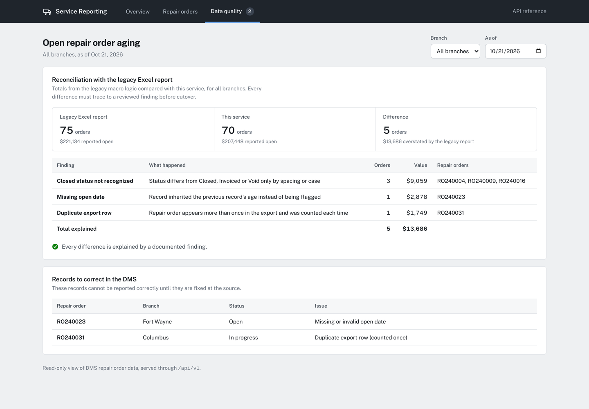
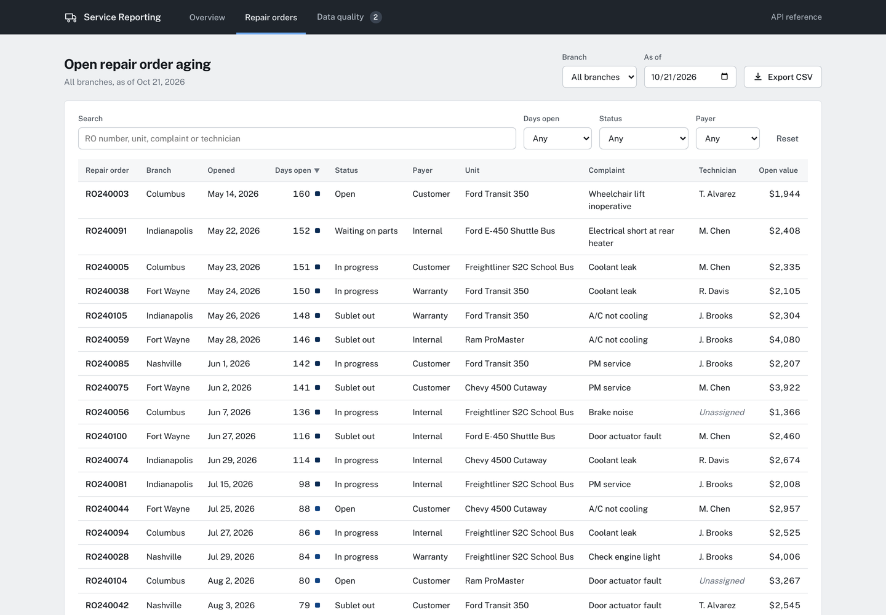

# Sample results

All figures are for the synthetic file `data/sample/repair_orders.csv`, all branches, report date 21 October 2026. That is the date in the generator, the tests, the page default, and the screenshots.

The API and the tests use cents. The web page rounds each dollar amount with JavaScript `Math.round`. Counts are the same in both places. The "On the page" column is the rounded amount the screenshots show. Where a table has an "All" row, the rounded rows above it add up to that rounded total. The three finding amounts add up to the gap in the headline table.

## How 121 rows become 70 open orders

The file has 121 data rows and 120 RO numbers. RO240031 is the repeated one.

| Rows | What they are |
| ---: | --- |
| 46 | Status is exactly `Closed` (13), `Invoiced` (15), or `Void` (18). The macro and the service both drop these. |
| 3 | Status is `Closed `, `closed`, or `INVOICED` (RO240004, RO240009, RO240016). The macro keeps them. The service treats them as closed. |
| 1 | RO240023, status `Open`, open date blank. The macro keeps it and reuses the previous age. The service lists it as an exception and does not age it. |
| 1 | The extra copy of RO240031. The macro counts both copies. The service keeps one. |
| 70 | Open orders the service reports. |
| 121 | Rows in the file. |

The macro's open count is 121 − 46 = 75. The service's open count is 75 − 3 − 1 − 1 = 70. The $13,685.97 gap is the labor and parts on those five extra inclusions, not a different price on the 70.

One correction at a time leaves 72 orders if only status is normalized, 74 if only the blank date is dropped, and 74 if only the duplicate is removed. All three together leave 70.

## Headline

The README table is this same population: all branches on 21 October 2026, labor plus parts, in cents. Branch, status, and technician splits are the tables below.

| Report | Open ROs | Labor and parts | On the page |
| --- | ---: | ---: | ---: |
| Excel macro | 75 | $221,133.92 | $221,134 |
| This service | 70 | $207,447.95 | $207,448 |
| Macro minus service | 5 | $13,685.97 | $13,686 |

## Findings

From `GET /api/v1/reconciliation` at this date. `unexplained` is empty. The three finding dollar amounts sum to $13,685.97, and the rounded amounts sum to $13,686.

| Finding | Orders | Labor and parts | On the page | Repair orders |
| --- | ---: | ---: | ---: | --- |
| Closed status not recognized | 3 | $9,058.73 | $9,059 | RO240004, RO240009, RO240016 |
| Missing open date | 1 | $2,878.05 | $2,878 | RO240023 |
| Duplicate export row | 1 | $1,749.19 | $1,749 | RO240031 |

The exceptions list, which is the badge on the data-quality tab, has 2 rows: RO240023 (Fort Wayne, missing open date) and RO240031 (Columbus, duplicate). The three status rows are not in that list.

## By branch

A zero cell is a bucket with no orders. The chart draws no segment for it. Columbus and Fort Wayne have none in 8-15 days.

| Branch | 0-7 | 8-15 | 16-30 | 31-60 | 61-90 | 90+ | Orders | Labor and parts | On the page |
| --- | ---: | ---: | ---: | ---: | ---: | ---: | ---: | ---: | ---: |
| Columbus | 7 | 0 | 7 | 2 | 2 | 3 | 21 | $57,732.96 | $57,733 |
| Fort Wayne | 10 | 0 | 4 | 2 | 1 | 4 | 21 | $70,617.29 | $70,617 |
| Indianapolis | 2 | 3 | 2 | 1 | 2 | 4 | 14 | $35,097.92 | $35,098 |
| Nashville | 3 | 3 | 2 | 3 | 2 | 1 | 14 | $43,999.78 | $44,000 |
| All branches | 22 | 6 | 15 | 8 | 7 | 12 | 70 | $207,447.95 | $207,448 |

## By age bucket

| Bucket | Orders | Labor and parts |
| --- | ---: | ---: |
| 0-7 | 22 | $71,960.03 |
| 8-15 | 6 | $19,567.39 |
| 16-30 | 15 | $45,369.01 |
| 31-60 | 8 | $19,871.47 |
| 61-90 | 7 | $20,866.46 |
| 90+ | 12 | $29,813.59 |
| All | 70 | $207,447.95 |

Open over 30 days is the last three buckets: 8 + 7 + 12 = 27 orders, $70,551.52. The page shows 27 and 39%, which is `Math.round(27 / 70 * 100)`.

The oldest open order is RO240003, Columbus, opened 14 May 2026, 160 days, $1,943.56 ($1,944 on the page). The repair-order list is oldest first.

## By status, payer, and technician

Stored status is upper case. The page title-cases it (`IN PROGRESS` is shown as "In progress"). Unassigned means a blank technician.

| Status | Orders | Labor and parts | On the page |
| --- | ---: | ---: | ---: |
| OPEN | 25 | $76,280.65 | $76,281 |
| IN PROGRESS | 18 | $49,996.16 | $49,996 |
| SUBLET OUT | 15 | $48,730.27 | $48,730 |
| WAITING ON PARTS | 12 | $32,440.87 | $32,441 |
| All | 70 | $207,447.95 | $207,448 |

| Payer | Orders | Labor and parts | On the page |
| --- | ---: | ---: | ---: |
| Customer | 26 | $76,784.95 | $76,785 |
| Internal | 23 | $68,360.23 | $68,360 |
| Warranty | 21 | $62,302.77 | $62,303 |
| All | 70 | $207,447.95 | $207,448 |

| Technician | Orders | Labor and parts | On the page |
| --- | ---: | ---: | ---: |
| J. Brooks | 15 | $42,418.84 | $42,419 |
| M. Chen | 14 | $42,264.10 | $42,264 |
| Unassigned | 14 | $41,493.78 | $41,494 |
| R. Davis | 12 | $34,959.29 | $34,959 |
| K. Evans | 9 | $26,632.10 | $26,632 |
| T. Alvarez | 6 | $19,679.84 | $19,680 |
| All | 70 | $207,447.95 | $207,448 |

Unassigned is 14 of 70 orders, which the page shows as 20%.

## What the generator put in the file

`scripts/generate_sample_data.py` sets `random.seed(21)` and builds 120 orders, RO240001 through RO240120, with open dates from 14 May 2026 through 21 October 2026. Labor dollars are hours times 165, rounded to the cent. It then sets the three dirty closed statuses, clears RO240023's open date, and appends a second copy of RO240031. Running the script again rewrites this file.
